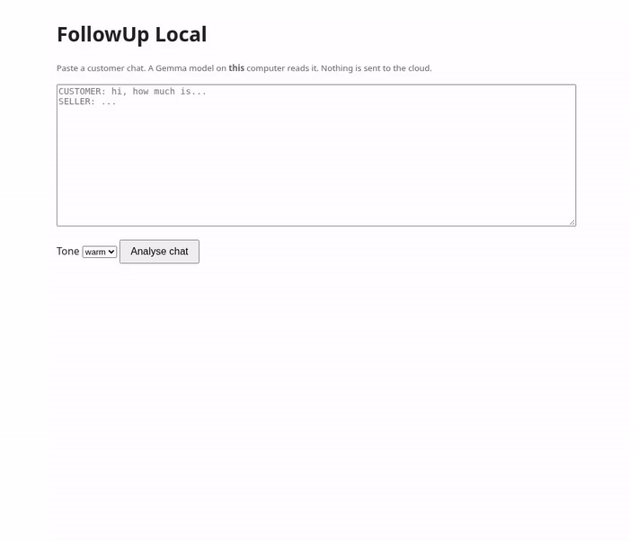

# FollowUp Local

Paste a customer chat. A **Gemma** model running on your own computer (via [Ollama](https://ollama.com)) tells you:

- **where the customer is stuck** (`waiting_on_someone_else`, `price_hesitation`, `gone_quiet`, ...)
- **the real concern** behind what they said
- **one line of evidence** quoted from the chat
- **the next message to send**, and when to send it

Nothing leaves your machine. No API key, no account, no per-message cost.

Built for the DEV Hacktoberfest 2026 Open-Source AI Challenge, Week 2 ("Side Hustle"), between Oct 12 and Oct 18, 2026.



## Who it is for

People who sell through chat and lose deals to silence: a candle maker on Instagram DMs, a bike mechanic on WhatsApp, a private tutor on WeChat.
Their customer chats are private, and they don't want to paste them into a cloud chatbot.

## Quick start

Requirements: Python 3.9+ (standard library only) and Ollama.

```bash
ollama pull gemma3:4b          # ~3.3 GB, works on CPU
python3 followup.py samples/candle_shop_sample.txt     # CLI
python3 followup.py --serve                            # web UI at http://127.0.0.1:8765
```

Options:

```bash
python3 followup.py chat.txt --tone brief       # warm | brief | direct
python3 followup.py chat.txt --json             # machine-readable output
cat chat.txt | python3 followup.py              # read from stdin
FOLLOWUP_MODEL=gemma3:1b python3 followup.py chat.txt   # smaller / faster model
```

Chat format: one message per line, prefixed with `CUSTOMER:` / `SELLER:` (also `客户：` / `老师：` etc.). Lines starting with `#` are ignored.

## How it works

1. The last 60 lines of the chat are cleaned up (full-width colons, comment lines).
2. A tiny keyword pass finds **signals** in the customer's lines (e.g. "check with her" -> `waiting_on_someone_else`, "the shop near my office said $60" -> `price_hesitation`). These are passed to the model as hints, not as answers.
3. Gemma gets a short system prompt, one worked example, and the chat. Ollama's **structured output** (a JSON schema with an enum of stages) forces a valid result.
4. If the quoted evidence is not actually in the chat, it is replaced with the last real customer line.
5. Chinese chats get an explicit "answer in Simplified Chinese" instruction.

All of this is ~200 lines in `followup.py`.

## Measured on a CPU-only box (8 vCPU, no GPU)

| model | time per chat | notes |
|---|---|---|
| gemma3:1b | ~6-9 s | picks the stage only with keyword hints; messages often generic |
| gemma3:4b | ~15-24 s | default; specific, uses the seller's own facts most of the time |

Sample outputs for the three bundled samples are in [`docs/sample-outputs/`](docs/sample-outputs/).

## Known limitations

- **Always read the message before sending it.** The 4B model sometimes adds things the seller never said (e.g. "I've just sent a photo", or a claim about a competitor). The prompt forbids it; it still happens occasionally.
- Stage labels are a judgment call, and the model can disagree with you.
- Long chats are cut to the last 60 lines.
- It does not read WhatsApp/WeChat export files directly yet; paste the text.

## Sample data

Everything in `samples/` is **fictional**, written for testing. No real customer conversations are included.

## License

MIT, see [LICENSE](LICENSE). Gemma models are subject to the [Gemma Terms of Use](https://ai.google.dev/gemma/terms).
